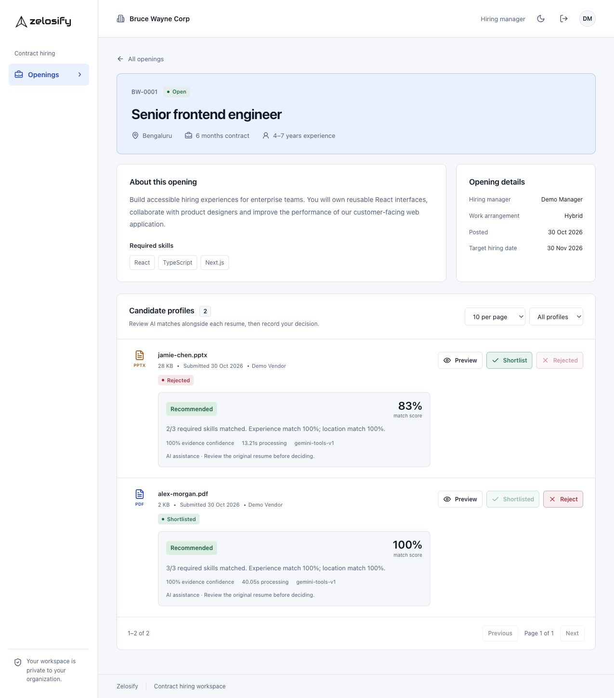

# Zelosify contract hiring workspace

A multi-tenant vendor-to-hiring-manager workflow built on the supplied Zelosify codebase. The development workflow includes openings, secure PDF/PPTX submissions, previews, soft deletion, manager decisions and a real Gemini tool-calling recommendation agent. The functional workflow is live verified, but the assignment's latency and 100-successful-profile provider benchmark gates are not met. See `docs/STEP_THREE.md` for measured results and limits.



## Verification status

- 50 automated tests pass, including real PostgreSQL integration and a 100-profile scripted-transport workflow.
- Clean-copy dependency installation, backend/frontend production builds and the isolated database suite pass.
- Real Keycloak, private S3, PDF/PPTX, Gemini tool calling and manager decisions are verified.
- **Performance gate failed:** no profile completed in the strict 1,500 ms / 100-profile run. The historical burst test completed 3/100, with 96 provider quota errors and one parser timeout. Passing code tests are not a passing provider SLA.

See [step-four status](docs/STEP_FOUR.md), [architecture](docs/ARCHITECTURE.md), [performance evidence](docs/evidence/), and the [continuous-demo walkthrough](docs/DEMO_WALKTHROUGH.md).

## Prerequisites

- Node.js 24 (see `.nvmrc`), npm, and Docker.
- A private AWS S3 bucket with versioning and working local AWS profile credentials. The local development profile is `zelosify` in `ap-southeast-2`; use your own authorized configuration on another machine.
- A Gemini API key with function-calling access is required for AI recommendations.

## Local setup

From `Zelosify-Backend/Server`:

```sh
npm ci
npm run setup:local
```

Fill in `S3_BUCKET_NAME` in the generated private `.env`; ensure its AWS profile can read/write that bucket. Keep credentials out of source control. The application uses the AWS SDK credential chain and does not require permanent keys in the repository.

```sh
docker compose up -d
```

Wait for `http://localhost:8080/auth/realms/Zelosify/.well-known/openid-configuration` to respond, then:

```sh
npm run prisma:deploy
npm run seed:local
npm run seed:hiring
npm run dev
```

In another terminal, from `Zelosify-Frontend`:

```sh
npm ci
npm run dev -- --hostname 127.0.0.1
```

Open `http://localhost:5173/login`. Backend: `http://localhost:5050/`. PostgreSQL: local port 5445. The Keycloak/Compose configuration is for development only and is bound to loopback.

## Demo users

All four users belong to Bruce Wayne Corp. Their generated password is `LOCAL_DEMO_PASSWORD` in the backend's private `.env`.

| Login | Role | Scope |
| --- | --- | --- |
| `vendor.demo` | IT vendor | Own uploads; all 12 tenant openings |
| `vendor.two` | IT vendor | A separate vendor's uploads |
| `manager.demo` | Hiring manager | Nine assigned openings |
| `manager.two` | Hiring manager | Three other assigned openings |

Public registration is intentionally blocked. A caller cannot choose their role or tenant. Local accounts are provisioned by the development scripts. Existing users with enrolled TOTP must still complete their second factor. Access tokens can be renewed using the HTTP-only refresh cookie.

## Verification

Backend:

```sh
npm run build
npm run test:local
npm run check:auth
npm run check:hiring
npm run check:connections
npm run check:recommendations
```

`npm run test:local` includes real-PostgreSQL integration tests with isolated in-memory file storage. It creates and removes disposable test tenants. `check:hiring` instead uses real Keycloak sessions and the configured S3 bucket. It submits a fictional PDF, exercises access denial and decisions, then soft-deletes its test submission. Original bytes remain in private S3 under the application's soft-delete policy. It briefly moves `vendor.two` into a disposable test tenant and restores it in a `finally` block; run this check only against the local development setup.

`npm run fixtures:demo` generates fictional PDF resumes under `.local/fixtures` for manual browser checks. The browser verification also used a fictional PPTX presentation. No real candidate records were used.

Frontend:

```sh
npm run build
npm run start -- --hostname 127.0.0.1
```

Stop the development frontend before a production build because both use `.next`. PDF.js worker assets are copied from the locked dependency automatically before dev/build/start.

## AI processing and timing

Submission creates durable background jobs. The agent uses actual Gemini function calls for parsing, evidence-backed extraction, normalization, deterministic matching/scoring and final validation. Only the assigned manager receives recommendation fields; vendors never receive them. The manager remains responsible for shortlist/reject decisions.

`AI_PROCESSING_TIMEOUT_MS` falls back to the brief's strict 1500 ms when unset. The development setup script generates 60000 ms (explicitly approved by Ritik), with `GEMINI_MIN_REQUEST_INTERVAL_MS=6000` to reduce provider quota errors. These settings do not demonstrate compliance with the original speed requirement. Live paced PDF/PPTX analyses took about 35 seconds; the initial 100-profile stress run completed only three profiles. More quota alone does not guarantee the latency target.

`npm run benchmark:ai` explicitly calls the live provider on synthetic profiles and writes evidence to `.local/`. It stops on quota exhaustion. The automated 100-profile test uses a scripted model transport and must not be represented as a live provider benchmark. `npm run test:local` provisions the separate localhost `zelosify_test` database so the application worker cannot claim disposable test jobs. CI uses its own ephemeral PostgreSQL service.

## Design and architecture

- `docs/ARCHITECTURE.md`: runtime flow, trust boundaries and operational limits.
- `docs/STEP_THREE.md`: AI architecture, configuration, validation, live results and unresolved performance gates.
- `docs/STEP_TWO.md`: implemented behavior, validation, API contract, and remaining boundaries.
- `docs/STEP_TWO_DESIGN.md`: visual direction and responsive layout.
- `docs/STEP_ONE.md`: historical foundation/setup report and AI architecture plan.

The source is published at [Ritik0712-ai/zelosify-contract-hiring](https://github.com/Ritik0712-ai/zelosify-contract-hiring). No production deployment or submission email has been completed. Production deployment requires a dedicated bucket-scoped workload role rather than the developer's broad local AWS project role.
