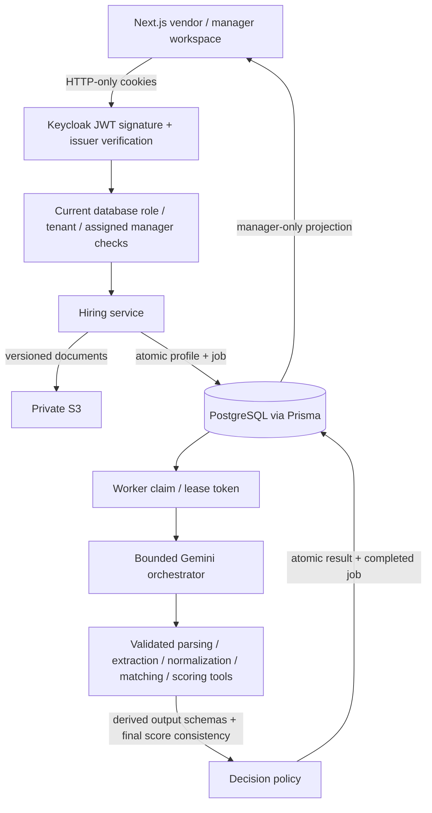

# Architecture and trust boundaries

The API authenticates the JWT against Keycloak's JWKS and issuer, then loads the role and tenant from the database. All profile access is filtered through the opening's tenant and, for managers, its assigned manager ID. Vendor queries additionally filter by uploader. Caller-supplied role or tenant values never establish access.

Uploads use backend-owned, expiring authorization tickets bound to exact metadata and ownership. The backend validates content before writing versioned objects to S3. A batch creates profiles and recommendation jobs in one transaction; storage compensation removes exact object versions on failure, retaining receipts if compensation itself fails. Soft deletion preserves audit records and private originals while denying future access.

A worker's lease token prevents stale workers from committing. Job retries are bounded. Deletion during processing invalidates result persistence. Completed results are not overwritten by ordinary replays. Manager-triggered retry is available only for failed jobs.

The model sees scoped DTOs and labelled untrusted document text, never raw ORM objects or arbitrary identifiers. It selects tools; code enforces prerequisites and validates inputs, outputs and persisted state. It can group normalization, matching and scoring calls to reduce network round trips; those tools still execute separately in dependency order. Scoring remains deterministic. Final recommendation values must match the scoring tool exactly.

Prompt-injection mitigations include a static system instruction, normalized text, no arbitrary URL/file/tenant tool arguments, evidence checks, strict schemas and authoritative score validation. These are safeguards, not a guarantee against every adversarial resume. Hidden chain-of-thought is neither requested nor stored. Opaque provider signatures are retained transiently for protocol correctness only.

Structured audit traces, token counts, stage durations and safe errors provide observability. Reachable authentication and startup logs omit full user objects and raw provider errors. The unused generic storage-list route is not mounted; hiring files are served only through scoped endpoints.

## Operational boundaries

This is a local evaluation build, not a deployed production service. Local Keycloak uses development mode and loopback bindings. Production requires HTTPS, workload credentials restricted to a dedicated bucket, an operations process for failed storage compensation/stale uploads, a shared provider limiter across replicas, data-retention policies and further adversarial evaluation.

Latency remains a failed acceptance gate. Async work keeps model processing out of the submission request, but uploads still wait for durable S3 writes. Longer development deadlines and request pacing are explicitly documented; they are not claimed to meet the original SLA.
